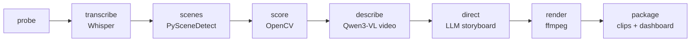

<div align="center">

# ReelWeave

**Turn raw travel vlogs into TikTok/Reels — fully local, on your Mac. No cloud, no API keys.**

[](LICENSE)
[](https://www.python.org)
[](https://www.apple.com/mac/)
[](https://github.com/ml-explore/mlx)
[](https://github.com/astral-sh/ruff)

</div>

ReelWeave ingests a folder of raw vertical footage and edits it into **share-ready short-form
videos** — chronological, part-based trip recaps **plus** activity supercuts (e.g. "tasting local
beers") — with burned-in karaoke subtitles. Everything runs **on-device**: speech recognition, a
vision model that *watches* your clips, and an LLM "director" that plans the edit. No uploads, no
subscriptions, no watermarks.

## Why ReelWeave?

- 🔒 **Fully local / offline.** Whisper + Qwen3-VL (Apple MLX) + Ollama + ffmpeg. Your footage never
  leaves the machine; no API keys, no cloud bill.
- 🎬 **Narrative, not just clips.** Most tools extract isolated "viral moments". ReelWeave
  reconstructs a **timetable** of your trip and edits it into ordered **Part 1 / Part 2 …** stories,
  plus cross-clip **supercuts** by activity.
- 🧠 **Transparent director architecture.** An LLM produces an inspectable JSON storyboard, then a
  **deterministic ffmpeg render** executes it. Reproducible and hackable — not an opaque SaaS.
- 🍏 **Apple Silicon native.** Metal-accelerated MLX models; hardware H.264 via VideoToolbox.

## How it works



**Understand → Direct → Render.** The understanding stages write a structured `asset graph`; the
LLM only emits JSON (titles, narrative, hook verification); the renderer is pure, deterministic
ffmpeg.

## Requirements

| Component | Model | Approx. unified memory |
|---|---|---|
| Speech-to-text | Whisper large-v3 (MLX) | ~3–4 GB |
| Vision (video) | Qwen3-VL-8B (MLX, 4-bit) | ~6–8 GB |
| Director LLM | qwen3 (Ollama, Q4) | ~5 GB |

- **macOS on Apple Silicon** (M-series). 16 GB unified memory minimum; **32 GB+ recommended** to run
  all models without swapping (uses unified memory, not VRAM).
- [`ffmpeg`](https://ffmpeg.org) **built with libass** (e.g. Homebrew `ffmpeg-full`) for subtitle
  burn-in, and [`ollama`](https://ollama.com) for the director LLM.

## Quickstart

```bash
# 1. System tools (Homebrew)
brew install ffmpeg-full ollama
brew services start ollama

# 2. Install ReelWeave (uv recommended)
uv tool install reelweave        # or: pipx install reelweave

# 3. Download the local models
reelweave setup                  # pulls Whisper + Qwen3-VL (MLX) and ollama models

# 4. Edit a folder of footage
reelweave run --source ./footage --config config.yaml
open output/index.html           # review dashboard
```

## Configuration

All behaviour lives in `config.yaml` — clip lengths, subtitle styling, the vision/LLM models,
output mode (`parts` vs `reels`), and language. ReelWeave is language-agnostic: set `language` and
optional `location_hints` / `name_fixes` for your trip (see [`examples/`](examples/) for a complete
worked configuration).

```yaml
language: "en"                # output/subtitle language
output_mode: "parts"          # "parts" = long-form trip series | "reels" = short clips
vision:   { engine: "mlx", mlx_model: "mlx-community/Qwen3-VL-8B-Instruct-4bit" }
ollama:   { model: "qwen3:32b" }
```

## Output

```
output/clips/NN_slug/
    clip.mp4        # share-ready 1080×1920 / 30fps, subtitles burned in
    caption.txt     # description + hashtags
    cover.jpg       # cover frame
    meta.json       # storyboard: segments, source clips, narrative
output/index.html   # review dashboard for all clips
```

## How the pipeline thinks

The footage is split into **sub-windows** and described by a video VLM, fused with the transcript
into an `asset graph`. A deterministic **timetable** groups clips by day → time-gap/location into
chapters and packs them into ~3-minute parts (chronology is enforced in code, never left to the
LLM). Activity **supercuts** are assembled across the whole trip. The LLM names parts/chapters,
writes the narrative and **verifies every hook against on-screen evidence** to avoid fabrication.

## Roadmap

- [ ] Configurable transition packs
- [ ] Optional music bed with side-chain ducking
- [ ] GPS-aware chaptering (DJI `.SRT` telemetry)
- [ ] Per-platform export presets (Reels / TikTok / Shorts)
- [ ] CUDA / Linux backend

## Contributing

Issues and PRs welcome — see [CONTRIBUTING.md](CONTRIBUTING.md).

## Acknowledgements

Built on [Whisper](https://github.com/openai/whisper), [Apple MLX](https://github.com/ml-explore/mlx)
& [mlx-vlm](https://github.com/Blaizzy/mlx-vlm), [Qwen3-VL](https://github.com/QwenLM/Qwen3-VL),
[Ollama](https://ollama.com), [PySceneDetect](https://www.scenedetect.com) and
[ffmpeg](https://ffmpeg.org).

## License

[MIT](LICENSE) © 2026 Yusufhan Saçak
